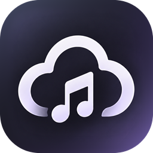
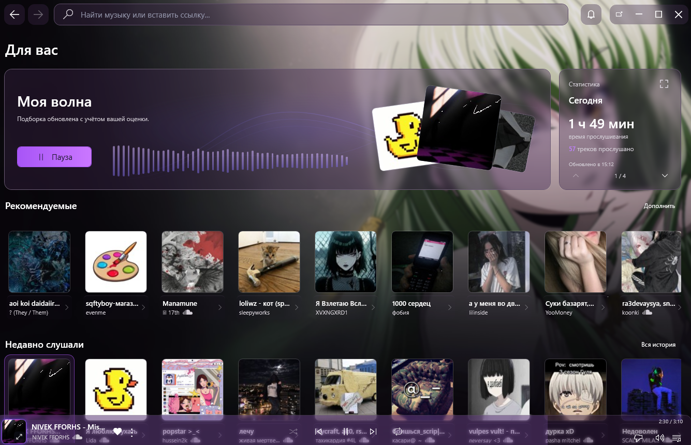
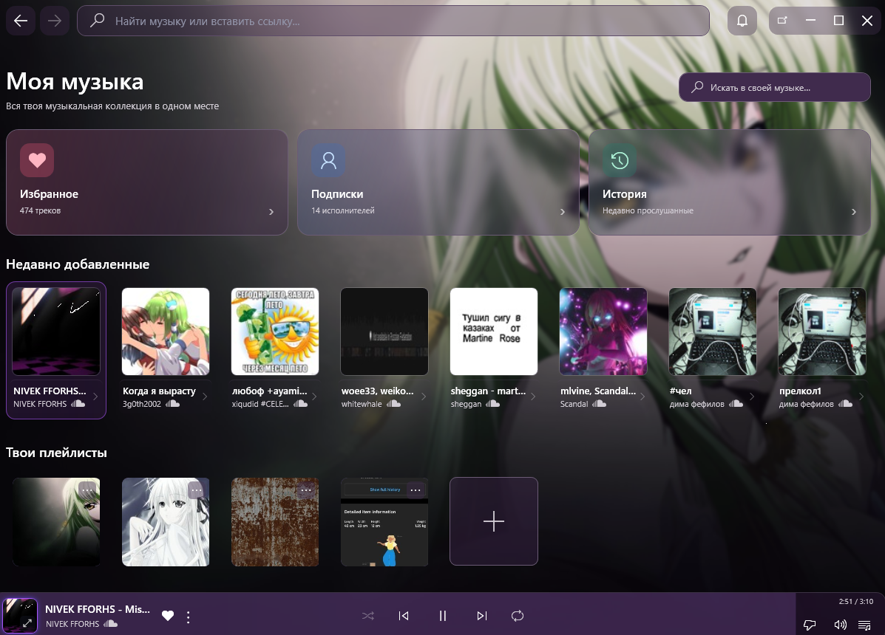

  

<h1 align="center">Cloudfy</h1>

  Музыкальный плеер, в котором можно находить новое, сохранять любимое 
  и слушать вместе с друзьями.

  <a href="https://cloudfyy.onrender.com/">Официальный сайт</a> ·
  <a href="https://github.com/hopmaa/Cloudfy.exe/releases/latest/download/CloudfyDesktop-win-Setup.exe">Скачать для Windows</a> ·
  <a href="https://cloudfyy.onrender.com/downloads/Cloudfy.apk">Скачать для Android</a> ·
  <a href="https://cloudfyy.onrender.com/app/">Открыть в браузере</a>

Здесь публикуются обновления **Cloudfy для Windows**. На телефоне и в браузере можно войти в тот же аккаунт и продолжить пользоваться своей музыкальной коллекцией.

## Как выглядит Cloudfy

Главная в Windows: «Моя волна», рекомендации, статистика и недавно прослушанная музыка.

  
Ещё скриншоты: музыкальная коллекция и плеер на телефоне

  
«Моя музыка» в Windows — избранное, подписки, история и плейлисты.

  

  
Большой плеер в приложении для Android.

  

На скриншотах — настоящее приложение с настроенным фоном. Оформление можно менять под себя.

## Что можно делать

**Находить музыку в «Моей волне».** Подборка учитывает твои вкусы и оценки треков. Отмечай, что нравится, чтобы помогать рекомендациям.

**Собирать свою коллекцию.** Сохраняй треки в избранное, создавай плейлисты и подписывайся на исполнителей. Если забыл название недавно услышанной песни, загляни в историю.

**Слушать вместе.** В приложениях для Windows и Android можно пригласить друзей в комнату и слушать общую музыку.

**Продолжать на другом устройстве.** Избранное, плейлисты и подписки синхронизируются через аккаунт Cloudfy. Для получения изменений нужен интернет.

**Настраивать приложение под себя.** В Windows можно выбрать свой фон, цвета и прозрачность интерфейса. Необязательно оставлять оформление как на скриншотах.

В Cloudfy также есть статистика прослушиваний. А в Windows можно включить показ текущего трека в статусе Discord — это отдельная настройка, по желанию.

## Установка и первый запуск

### Windows

1. [Скачай установщик](https://github.com/hopmaa/Cloudfy.exe/releases/latest/download/CloudfyDesktop-win-Setup.exe) из последнего релиза и запусти `CloudfyDesktop-win-Setup.exe`.
2. Открой Cloudfy, создай аккаунт или войди в существующий.
3. Найди любимую песню или включи «Мою волну».

Для установки нужен именно файл **Setup.exe**. Остальные файлы в релизе используются системой обновлений. Новые версии можно посмотреть в [Releases](https://github.com/hopmaa/Cloudfy.exe/releases).

### Android

[Скачай APK с официального сайта](https://cloudfyy.onrender.com/downloads/Cloudfy.apk) и открой его на телефоне. Если Android попросит, разреши установку из используемого браузера или файлового менеджера. Поддерживается **Android 8 и новее**; сейчас распространяется тестовая сборка.

Для синхронизации войди в тот же аккаунт, что используешь на компьютере.

### Браузер и iPhone

[Открой веб-плеер](https://cloudfyy.onrender.com/app/) и войди в Cloudfy. В браузере доступны поиск треков и исполнителей, «Моя волна», избранное, плейлисты и статистика. Веб-версия пока в бета-тесте; набор возможностей отличается от приложений.

На iPhone открой плеер в Safari и выбери **«Поделиться» → «На экран Домой» → «Добавить»**. Это веб-версия, а не отдельное приложение для iOS. Фоновое воспроизведение и системные кнопки могут работать по-разному в зависимости от версии iOS.

## Откуда музыка

Cloudfy использует **SoundCloud** как источник музыкального контента. Это независимый проект, не официальный клиент и не продукт SoundCloud.

Доступность музыки зависит от SoundCloud и подключения к его серверам. Если треки не загружаются, на сайте есть [инструкция по проблемам с доступом](https://cloudfyy.onrender.com/#network-help) для пользователей Windows.

## Обратная связь и обновления

- **Нашёл ошибку или хочешь предложить функцию?** Создай [обращение в Issues](https://github.com/hopmaa/Cloudfy.exe/issues). Для ошибки укажи платформу, версию Cloudfy и действия, после которых она возникает.
- **Ищешь новую версию?** Установщики и история обновлений находятся в [Releases](https://github.com/hopmaa/Cloudfy.exe/releases).
- **Есть вопрос разработчику?** Способы связи и обращения по данным или правам описаны на [странице контактов](https://cloudfyy.onrender.com/contacts.html).

Issues видны всем: не добавляй туда пароли, коды подтверждения, токены и другие личные данные.
